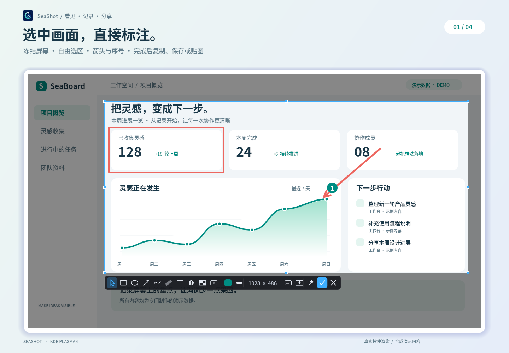
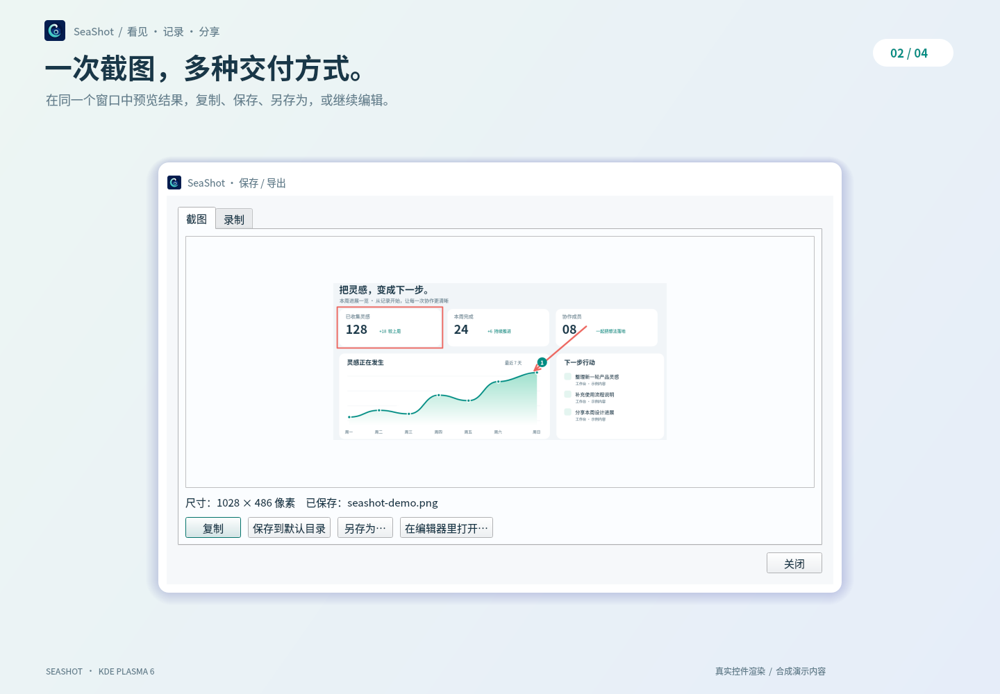
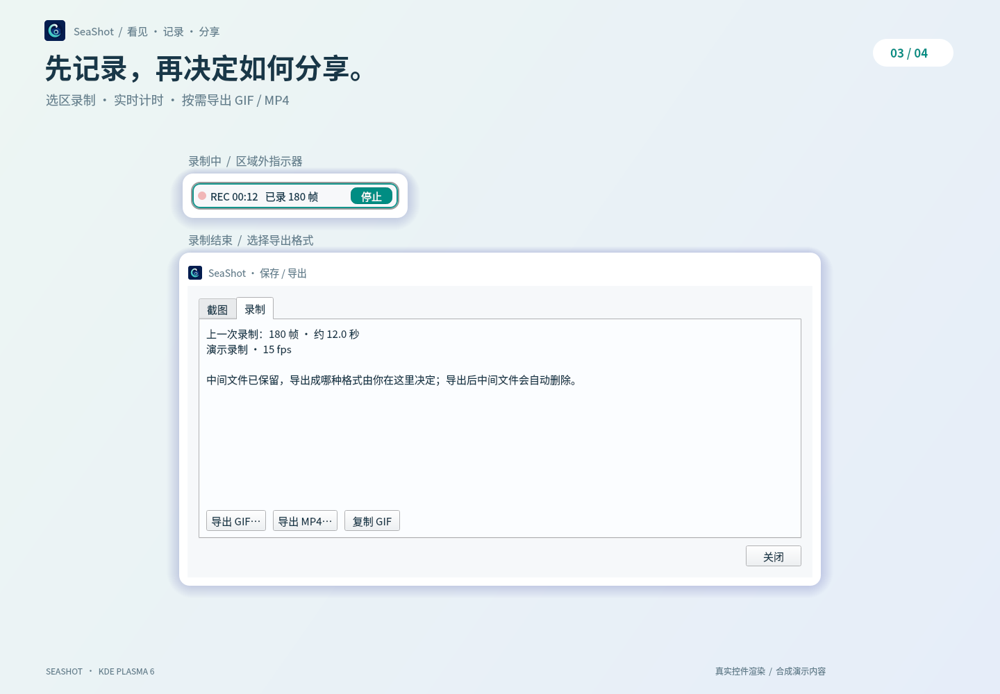
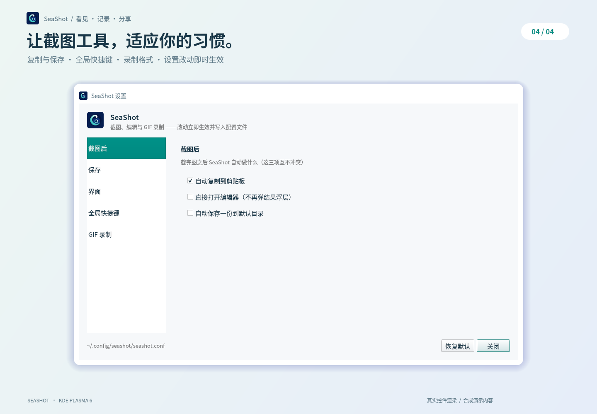

<p align="center">
  
</p>

<h1 align="center">🌊 SeaShot</h1>

<p align="center">
  <strong>为 KDE Plasma 6 打造的截图与录屏工具</strong><br>
  选取、标注、贴图、长截图，把屏幕上的灵感留下来。✨
</p>

<p align="center">
  🐧 Linux · 🖥️ KDE Plasma 6 · ⚡ C++20 · 🧩 Qt 6<br>
  📸 Wayland / X11 · 🎨 就地标注 · 🎬 GIF / MP4
</p>

---

## ✨ 能做什么

| 功能 | 说明 |
| --- | --- |
| 📸 窗口与区域截图 | 悬停识别窗口，单击选取；也可拖动框选任意区域 |
| ✏️ 就地标注 | 在冻结画面上画矩形、椭圆、箭头、画笔、高亮、文字与序号 |
| 🫧 模糊与马赛克 | 在选区中处理需要遮盖的区域 |
| 📌 屏幕贴图 | 将截图钉在屏幕上，支持拖动、缩放和多张并存 |
| 📜 滚动长截图 | 自己滚动页面，自动对齐并拼接，手动确认完成 |
| 🔎 OCR 文字识别 | 识别图片或当前选区中的文字，支持选择语言 |
| 🎬 GIF / MP4 录制 | 选区录制、定时停止，录完再选格式，或通过命令行直接导出 |
| ⌨️ 全局快捷键 | 支持系统授权注册、KDE 设置及自定义命令 |
| 🎨 跟随系统主题 | 界面使用系统调色板与图标主题 |

> 💡 截图完成后默认复制到剪贴板，不弹出结果窗口。需要保存、另存或编辑时，打开托盘菜单中的 **「保存 / 导出上一次结果…」**。

## 🖼️ 功能演示

使用真实 SeaShot 控件渲染，工作台内容与录制数据均为演示样例。界面颜色随系统主题变化，点击图片可查看大图。

<table>
  <tr>
    <td width="50%">
      <a href="docs/images/capture-annotate.png"></a>
      <p align="center"><strong>📸 选中画面，直接标注</strong></p>
    </td>
    <td width="50%">
      <a href="docs/images/save-export.png"></a>
      <p align="center"><strong>💾 一次截图，多种交付方式</strong></p>
    </td>
  </tr>
  <tr>
    <td width="50%">
      <a href="docs/images/recording-export.png"></a>
      <p align="center"><strong>🎬 先记录，再选择分享格式</strong></p>
    </td>
    <td width="50%">
      <a href="docs/images/settings.png"></a>
      <p align="center"><strong>⚙️ 适应你的截图习惯</strong></p>
    </td>
  </tr>
</table>

## 🚀 构建与安装

### 🧩 准备依赖

| 类型 | 依赖 |
| --- | --- |
| 🏗️ 构建工具 | 支持 C++20 的编译器、CMake ≥ 3.21、Ninja、pkg-config |
| 🪟 界面与桌面 | Qt ≥ 6.5：Core、Gui、Widgets、DBus、Network、Test；KF6 GlobalAccel、KF6 StatusNotifierItem；LayerShellQt |
| 🔌 X11 后端（可选） | `xcb`、`xcb-shm`、`xcb-ewmh`；缺失时自动关闭 X11 后端 |
| 📡 PipeWire 帧源（可选） | `libpipewire-0.3`；缺失或不可用时回退截图轮询 |
| 🎞️ 录制与导出 | `ffmpeg`，包含 FFV1、libx264 及 GIF 调色板滤镜；部分测试还需要 `ffprobe` |
| 📋 Wayland 剪贴板 | 推荐安装 `wl-clipboard`，使用 `wl-copy` 持久化复制结果 |
| 🔤 OCR（可选） | `tesseract` 及所需语言包，例如 `chi_sim`、`eng` |

### 🔨 编译

在项目根目录执行：

```bash
cmake -S . -B build -G Ninja -DCMAKE_BUILD_TYPE=Release
cmake --build build -j 2
```

### 📦 安装到当前用户

```bash
./install.sh --no-build    # 安装刚才构建的版本，无需 sudo
```

也可以让安装脚本完成构建：

```bash
./install.sh              # 构建并安装
./install.sh --autostart  # 构建、安装并添加登录自启
```

程序安装到 `~/.local/bin/seashot`，应用菜单入口安装到 `~/.local/share/applications/seashot.desktop`。
应用图标使用 `resources/icons/seashot.png`，安装脚本会将它复制到用户图标目录，并在菜单与自启入口中使用 `seashot` 图标。
如果终端找不到 `seashot`，可先使用完整路径 `~/.local/bin/seashot`。

> 🔑 **Wayland 下请通过安装脚本安装。** 脚本会写入 KWin 截图所需的 desktop 授权声明，并刷新 KDE 应用缓存。直接从构建目录运行，可能出现 `Error.NoAuthorized`。

## 📸 开始截图

按下截图快捷键后，SeaShot 会先冻结当前画面，再显示选框，保留托盘菜单和右键菜单。设置、编辑器等普通窗口可以截图；截图选框、贴图和录制指示器仍会被排除。

```bash
seashot                     # 常驻托盘
seashot --capture           # 开始交互式截图，已有实例时转交给它
seashot --settings          # 打开设置
```

1. 🖱️ **选择**：单击窗口，或按住鼠标拖出矩形。
2. ✏️ **标注**：选区确定后，在冻结画面上使用工具条；边框和手柄可继续调整选区。
3. ✅ **完成**：按 `Enter` 或点击 ✓，按设置复制或保存。结果保留冻结画面的原始物理分辨率。

### ⌨️ 选区内的常用快捷键

| 按键 | 操作 |
| --- | --- |
| `1`–`9` | 选择、矩形、椭圆、箭头、画笔、高亮、文字、序号、马赛克 |
| `Ctrl+Z` / `Ctrl+Shift+Z` / `Ctrl+Y` | 撤销 / 重做 |
| `Delete` | 删除选中的标注 |
| 方向键 / `Shift` + 方向键 | 微调选区 1 / 10 逻辑像素 |
| `Ctrl+A` | 选取整个虚拟桌面 |
| `Ctrl+C` | 完成并复制 📋 |
| `Ctrl+S` | 完成并保存到默认目录 💾 |
| `Ctrl+T` | 完成并贴图 📌 |
| `Ctrl+L` | 开始滚动长截图 📜 |
| `Ctrl+O` | 识别选区文字 🔎 |
| `Enter` / 双击 / ✓ | 完成，按设置交付结果 |
| `Esc` / 右键 / ✕ | 取消；有面板或编辑状态时先退出当前状态 |

🫧 模糊工具可在工具条中点击选择；颜色与线宽也可在工具条调整。

## 🎬 录制 GIF / MP4

```bash
seashot --record                          # 交互选择录制区域
seashot --record --rect 300,200,320,240    # 直接录指定区域
seashot --record --seconds 10             # 开始后 10 秒自动停止
seashot --record-stop                     # 停止常驻实例的录制
```

🎞️ 交互式录制结束后自动打开「保存 / 导出」窗口，可以选择 GIF 或 MP4。
也可以指定路径，按扩展名直接导出：

```bash
seashot --record --rect 300,200,320,240 --seconds 10 --save clip.mp4
seashot --record --rect 300,200,320,240 --seconds 10 --save clip.gif
```

📡 录制优先尝试 PipeWire，需要已有的 portal 授权 token；不可用时回退到截图轮询。
帧率默认 15 fps，可在设置中调整。慢帧或丢帧时使用上一帧补足时间轴，保持播放时长；MP4 的奇数宽高向右或向下补齐 1 像素。

💽 中间文件保存在 `~/.cache/seashot/recording/`。默认使用 FFV1 无损格式，也可在设置中选择体积更小的 H.264。导出后删除中间文件；临时空间不足时会提前停止采集。

## 📜 长截图 · 🔎 OCR · 📌 贴图

| 功能 | 使用方式 | 小提示 |
| --- | --- | --- |
| 📜 滚动长截图 | 选区后按 `Ctrl+L`，然后自己滚动页面 | 点击指示器「完成」或按 `Esc` 结束；高度 20,000 px / 时长 30 分钟兜底 |
| 🔎 OCR | 选区后按 `Ctrl+O`，或运行 `seashot --ocr image.png` | 结果面板支持复制全部、选中文字或当前行 |
| 📌 贴图 | 选区后按 `Ctrl+T`，或运行 `seashot --pin image.png` | 按住拖动，滚轮缩放，右键打开菜单 |

```bash
# 📜 由你滚动页面，最多采集 30 秒
seashot --scroll-capture --rect 100,100,800,600 --scroll-ms 30000 --save long.png

# 🔤 使用指定 OCR 语言
seashot --ocr image.png --ocr-langs chi_sim+eng

# 📌 将已有图片钉到屏幕上
seashot --pin image.png
```

> 📌 Wayland 下，SeaShot 的覆盖层与贴图会被自排除出后续截图。长截图需要你手动滚动，程序不会注入滚动事件。

## ⌨️ 设置全局快捷键

🛡️ 推荐打开 **「设置 → 全局快捷键 → 向系统申请注册」**，在系统授权对话框中选择按键。
首次启动且没有任何绑定时，程序可能自动请求一次授权，是否允许由你决定。

```bash
seashot --hotkey-portal-request    # 发起系统授权
seashot --hotkey-portal-configure  # 打开系统的改键对话框
seashot --hotkey-portal-status     # 查看门户绑定状态
seashot --hotkey-status            # 查看快捷键状态
```

也可通过 KDE 系统设置修改绑定，或将 `seashot --capture` 添加为自定义快捷键命令。
程序没有预设的全局按键；录制中按已绑定的截图快捷键会停止录制。

## 🛠️ 命令行与配置

```bash
# 🖥️ 整屏、矩形、指定窗口
seashot --capture-screen --save full.png
seashot --rect 100,200,400,300 --save rect.png --no-copy
seashot --list-windows
seashot --window '{window-handle}' --save window.png

# 🎨 打开图片编辑器
seashot --edit image.png

# 🔧 更多选项和当前配置
seashot --help
seashot --print-config
```

⚙️ 设置改动即时生效，配置文件位于 `~/.config/seashot/seashot.conf`。

| 配置键 | 默认值 | 作用 |
| --- | --- | --- |
| `capture/copyAfterCapture` | `true` | 截图后自动复制 |
| `capture/autoSave` | `false` | 截图后自动保存 |
| `capture/saveDir` | `~/Pictures/Screenshots` | 默认保存目录 |
| `capture/openEditorAfterCapture` | `false` | 截图后打开编辑器 |
| `capture/keepShadowMargin` | `true` | 直接截取窗口时保留阴影边距 |
| `shortcut/hotkey` | 空 | KGlobalAccel / X11 路径的快捷键配置；门户绑定由系统保存 |
| `record/fps` | `15` | 录制帧率 |
| `record/format` | `lossless` | 中间格式：`lossless` 或 `mp4` |
| `ui/trayPersistent` | `true` | 显示常驻托盘 |

<details>
<summary>🧪 开发与诊断</summary>

```bash
# 单元与集成测试：offscreen 避免测试窗口打扰桌面
QT_QPA_PLATFORM=offscreen ctest --test-dir build --output-on-failure

# 强制轮询录制帧源，便于排查 PipeWire 问题
SEASHOT_RECORD_POLLING=1 seashot --record

# 本次截图跳过就地标注
SEASHOT_INPLACE_ANNOTATE=0 seashot --capture
```

有 `dbus-run-session` 时，测试会在独立 D-Bus 中模拟截图服务，覆盖迟到响应和资源回收。
README 配图可通过 [演示图生成说明](docs/images/README.md) 重新制作。
日志输出到 stderr，常见前缀有 `[app]`、`[shot2]`、`[record]`。
`seashot --selftest` 会实际测试截图与剪贴板，手动诊断时按需运行。

</details>

## 🧭 兼容性与边界

主要面向 KDE Plasma 6 / KWin Wayland。X11 后端提供映射测试与 XWayland 冒烟验证，完整 X11 桌面、多显示器混合缩放和真实桌面的分数缩放仍需更多验收。合成测试已覆盖 100%、125%、200% 的冻结截图导出。

更详细的说明见 [兼容性与已知限制](docs/limitations.md)。

## 🗂️ 项目结构

```text
SeaShot/
├── src/
│   ├── app/          # 应用、托盘、设置与保存导出
│   ├── backend/      # Wayland / X11 截图后端
│   ├── editor/       # 标注、编辑器与撤销重做
│   ├── overlay/      # 选区覆盖层与就地工具条
│   ├── record/       # PipeWire / 轮询、录制与编码
│   ├── scroll/       # 长截图采集与拼接
│   └── ocr/          # 文字识别
├── resources/        # 应用图标与内嵌 KWin 脚本
├── tests/            # QtTest 测试
├── scripts/          # 验收与诊断脚本
├── probes/           # 可重复执行的能力探测源码
├── docs/             # 技术文档
└── install.sh        # 用户级安装脚本
```

🧹 构建产物、探测输出、验收截图和本地开发记录已纳入 `.gitignore`；源码、测试、资源与可复用脚本保留在版本控制中。
